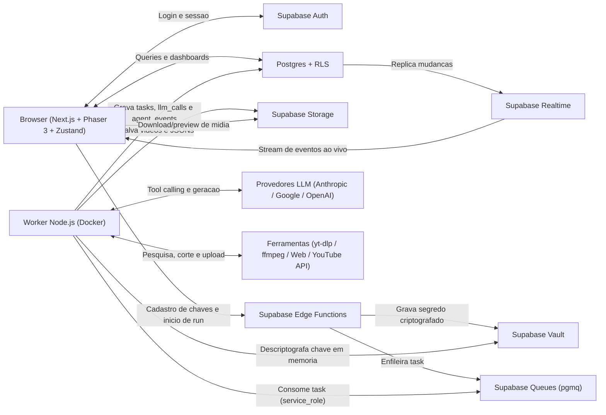
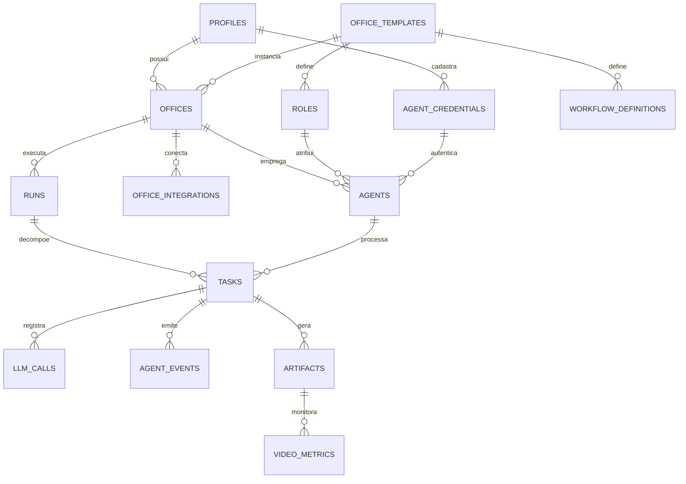
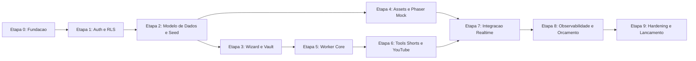

# Especificação Técnica e Plano de Implementação — WorkOffice (Provisório)

> **Projeto Supabase alvo:** `jphdogyddahozpcgktdz`  
> **Status do documento:** Especificação de arquitetura e roadmap segmentado em etapas (MVP + evolução).

---

## 1. Visão Geral

O **WorkOffice** é um SaaS que combina **orquestração e observabilidade de agentes de IA** com uma **interface visual interativa estilo jogo retrô isométrico**. Em vez de acompanhar pipelines de agentes apenas por logs em texto, o usuário cria um escritório virtual, contrata agentes configurados por cargo e provedor de IA, acompanha cada ação real acontecendo em tempo real pelo escritório e audita custos, tokens e artefatos gerados.

No MVP, o sistema nasce focado no modelo de escritório **"Estúdio de Shorts para YouTube"**, no qual um time de até 3 agentes colabora em sequência (pesquisa/roteiro → edição/legenda → publicação/monitoramento de desempenho).

### Glossário do Domínio

| Termo | Definição |
| :--- | :--- |
| **Modelo de escritório (`office_template`)** | Planta pré-definida de um tipo de negócio (salas, móveis, pontos de interação e limite de vagas). No MVP existe apenas 1 modelo: Estúdio de Shorts para YouTube. |
| **Escritório (`office`)** | Instância criada e nomeada pelo usuário a partir de um modelo, onde seus agentes operam. |
| **Sala (`room`)** | Área funcional dentro do mapa do escritório (ex.: baia de trabalho, sala de reunião, copa/descanso). |
| **Cargo (`role`)** | Definição de função dentro de um modelo, especificando escopo, formato de entrada/saída, ferramentas permitidas e nível de esforço padrão. |
| **Agente / Empregado (`agent`)** | Instância contratada pelo usuário para ocupar uma vaga/baia de um cargo, com sprite, provedor, modelo de LLM, nível de esforço, chave de API e orçamento próprios. |
| **Execução (`run`)** | Uma rodada completa do fluxo de trabalho do escritório disparada pelo usuário (ex.: produzir 3 Shorts a partir de um podcast específico). |
| **Tarefa (`task`)** | Unidade de trabalho dentro de uma `run` executada por um agente específico em um cargo. |
| **Evento (`agent_event`)** | Registro em tempo real emitido pelo backend quando um agente muda de estado ou usa uma ferramenta; dirige as animações no jogo e o feed de atividades. |
| **Artefato (`artifact`)** | Resultado tangível produzido por uma tarefa (JSON de pesquisa, vídeo cortado MP4, arquivo de legenda, relatório de métricas). |
| **Handoff** | Passagem formal do resultado validado de um agente para o próximo cargo no grafo de execução (ex.: Roteirista entrega pauta ao Editor). |

---

## 2. Stack Decidida

| Camada | Tecnologia / Escolha | Justificativa |
| :--- | :--- | :--- |
| **Monorepo** | `pnpm` + `Turborepo` | Separa `apps/web`, `apps/worker`, `packages/shared` (tipos e schemas Zod de eventos/cargos) e `supabase/` (migrations, seed, Edge Functions) com tipagem compartilhada. |
| **Frontend Web** | Next.js (App Router) + TypeScript + Tailwind CSS + Zustand | SSR/App Router para dashboard, onboarding e auth; Zustand para estado reativo leve sincronizado com o canvas do jogo. |
| **Engine do Jogo** | Phaser 3 (componente client-only) + `easystar.js` | Renderização pixel-art isométrica leve no navegador com pathfinding A* em grid invisível. |
| **Banco, Auth e Plataforma** | Supabase (`jphdogyddahozpcgktdz`): Auth, Postgres + RLS, Realtime, Storage, Vault, Queues (`pgmq`), Edge Functions | Centraliza autenticação, persistência multi-tenant com RLS, broadcast de eventos ao vivo, armazenamento de vídeos/artefatos, cofre criptografado de chaves e fila transacional. |
| **Worker de Agentes** | Node.js + TypeScript em container Docker dedicado (ex.: Fly.io ou Railway) | Tarefas como download de vídeos, processamento com `ffmpeg` e loops multi-step de LLM excedem os limites de tempo e memória de Edge Functions. Opera com `service_role`. |
| **Camada LLM** | Vercel AI SDK (`ai`, `@ai-sdk/anthropic`, `@ai-sdk/google`, `@ai-sdk/openai`) | Interface unificada para tool calling, contagem de tokens e parâmetros específicos de *reasoning/thinking* por provedor. |
| **Pipeline de Mídia** | `yt-dlp` + `ffmpeg` + transcrição configurável (OpenAI Whisper API ou Gemini áudio) | Permite baixar fontes autorizadas, recortar em 9:16, gerar legendas e renderizar *burn-in* no worker. |
| **Integração YouTube** | YouTube Data API v3 + YouTube Analytics API (OAuth 2.0) | Única forma oficial de enviar vídeos para o canal do usuário e ler métricas reais de retenção, visualizações e engajamento. |

---

## 3. Arquitetura

### Visão de Componentes



### Fluxo Completo de uma Execução (Cenário Podcast → Shorts)

```mermaid
sequenceDiagram
    actor User as Usuario
    participant Web as Frontend (Next.js + Phaser)
    participant Supa as Supabase (EF + DB + pgmq + Realtime)
    participant Worker as Worker de Agentes
    participant Ext as LLMs e APIs Externas

    User->>Web: Informa podcast alvo e dispara Run
    Web->>Supa: POST create-run (Edge Function)
    Supa->>Supa: Cria Run + Task 1 (Roteirista) + envia para pgmq
    Supa-->>Web: Realtime (task.started)
    Web->>Web: Personagem Roteirista anda ate a mesa 1

    Worker->>Supa: Le mensagem pgmq da Task 1
    Worker->>Ext: Busca tendencias/episodios + LLM (esforco configurado)
    Worker->>Supa: Emite agent_events (research.web_search, research.read_source)
    Supa-->>Web: Atualiza animacao (mesa CRT / estante) e log
    Worker->>Supa: Salva artifact (research_brief) + llm_calls + Task 2 (Editor)
    Worker->>Supa: Emite handoff.sent e handoff.received
    Supa-->>Web: Roteirista vai a sala de reuniao; Editor acorda e vai a mesa 2

    Worker->>Supa: Le mensagem pgmq da Task 2
    Worker->>Ext: yt-dlp + transcricao + ffmpeg (9:16 + legenda) + LLM
    Worker->>Supa: Emite eventos (edit.download, edit.cut, edit.subtitle, edit.render)
    Worker->>Supa: Upload MP4 no Storage + salva artifacts + cria Task 3 (Publicador)
    Worker->>Supa: Emite handoff.sent e handoff.received

    Worker->>Supa: Le mensagem pgmq da Task 3
    Worker->>Ext: Verifica cota diaria YouTube (max 6/dia): publica Short (<=6) ou agenda (>6) + metricas
    Worker->>Supa: Emite publish.upload, metrics.check e task.completed (URL do Short ou detalhe do agendamento)
    Supa-->>Web: Editor/Publicador exibem balao de conclusao, URL/agendamento e metricas no painel
```

---

## 4. Autenticação e Dados do Usuário

- **Métodos no MVP:** Sign up e login com **email e senha** via Supabase Auth, com confirmação de email obrigatória, recuperação de senha (*reset password*) e logout.
- **Tabela `profiles`:** Espelha dados básicos do usuário (`id` igual a `auth.users.id`, `display_name`, `avatar_url`, `plan`, `created_at`, `updated_at`).
- **Provisionamento automático:** Um trigger PostgreSQL `on_auth_user_created` em `auth.users` cria automaticamente a linha correspondente em `profiles`.
- **Isolamento multi-tenant (RLS):** Todas as tabelas do schema `public` (exceto catálogos públicos de leitura como `office_templates`, `roles` e `workflow_definitions`) têm Row Level Security ativada exigindo `owner_id = auth.uid()` diretamente ou via join com `offices.owner_id = auth.uid()`.
- **Permissão do Worker:** O worker utiliza `SUPABASE_SERVICE_ROLE_KEY` apenas no servidor (nunca exposta ao cliente), operando sob validação explícita de ownership na criação das tarefas.

---

## 5. Modelo de Dados

### Esquema SQL Base

```sql
-- Perfis de usuario (populado via trigger em auth.users)
create table public.profiles (
  id uuid primary key references auth.users(id) on delete cascade,
  display_name text,
  avatar_url text,
  plan text not null default 'free',
  created_at timestamptz not null default now(),
  updated_at timestamptz not null default now()
);

-- Catalogo de modelos de escritorio
create table public.office_templates (
  id uuid primary key default gen_random_uuid(),
  slug text unique not null,
  name text not null,
  description text not null,
  rooms jsonb not null,       -- coordenadas de salas, baias e hotspots
  map_config jsonb not null,  -- grid caminhavel, tileSize, escala isometrica
  max_agents integer not null,
  created_at timestamptz not null default now()
);

-- Cargos disponiveis por modelo de escritorio
create table public.roles (
  id uuid primary key default gen_random_uuid(),
  template_id uuid not null references public.office_templates(id) on delete cascade,
  slug text not null,
  name text not null,
  scope text not null,
  input_schema jsonb not null,
  output_schema jsonb not null,
  default_effort text not null check (default_effort in ('low', 'medium', 'high')),
  allowed_tools text[] not null default '{}',
  system_prompt text not null,
  workstation_type text not null,
  unique (template_id, slug)
);

-- Definicao do fluxo (DAG de cargos) por template
create table public.workflow_definitions (
  id uuid primary key default gen_random_uuid(),
  template_id uuid not null references public.office_templates(id) on delete cascade,
  version integer not null default 1,
  steps jsonb not null, -- ex: [{ "role_slug": "scriptwriter", "next": ["video_editor"] }, ...]
  created_at timestamptz not null default now()
);

-- Escritorios criados pelos usuarios
create table public.offices (
  id uuid primary key default gen_random_uuid(),
  owner_id uuid not null references public.profiles(id) on delete cascade,
  template_id uuid not null references public.office_templates(id),
  name text not null,
  status text not null default 'active' check (status in ('active', 'paused', 'archived')),
  created_at timestamptz not null default now()
);

-- Referencias para chaves de API armazenadas no Supabase Vault
create table public.agent_credentials (
  id uuid primary key default gen_random_uuid(),
  owner_id uuid not null references public.profiles(id) on delete cascade,
  provider text not null check (provider in ('anthropic', 'google', 'openai')),
  label text not null,
  vault_secret_id uuid not null, -- referencia ao segredo no Vault; chave real nunca fica nesta tabela
  last4 text not null,
  created_at timestamptz not null default now()
);

-- Agentes ("empregados") contratados para cada escritorio
create table public.agents (
  id uuid primary key default gen_random_uuid(),
  office_id uuid not null references public.offices(id) on delete cascade,
  role_id uuid not null references public.roles(id),
  name text not null,
  sprite_key text not null, -- ex: 'character_1' | 'character_2'
  provider text not null check (provider in ('anthropic', 'google', 'openai')),
  model text not null,
  effort text not null check (effort in ('low', 'medium', 'high')),
  credential_id uuid not null references public.agent_credentials(id),
  desk_slot text not null,  -- ex: 'desk_1' | 'desk_2' | 'desk_3'
  monthly_token_budget bigint,
  status text not null default 'idle' check (status in ('idle', 'working', 'paused_budget', 'error')),
  created_at timestamptz not null default now(),
  unique (office_id, desk_slot),
  unique (office_id, role_id)
);

-- Integracoes OAuth do escritorio (ex: canal do YouTube)
create table public.office_integrations (
  id uuid primary key default gen_random_uuid(),
  office_id uuid not null references public.offices(id) on delete cascade,
  provider text not null check (provider in ('youtube')),
  vault_secret_id uuid not null, -- refresh token OAuth no Vault
  channel_id text,
  metadata jsonb not null default '{}',
  created_at timestamptz not null default now(),
  unique (office_id, provider)
);

-- Execucoes disparadas pelo usuario
create table public.runs (
  id uuid primary key default gen_random_uuid(),
  office_id uuid not null references public.offices(id) on delete cascade,
  input jsonb not null,
  status text not null default 'queued' check (status in ('queued', 'running', 'completed', 'failed', 'cancelled')),
  started_at timestamptz,
  finished_at timestamptz,
  total_tokens bigint not null default 0,
  total_cost_usd numeric(12, 6) not null default 0,
  created_at timestamptz not null default now()
);

-- Tarefas individuais por agente dentro de uma execucao
create table public.tasks (
  id uuid primary key default gen_random_uuid(),
  run_id uuid not null references public.runs(id) on delete cascade,
  agent_id uuid not null references public.agents(id),
  role_id uuid not null references public.roles(id),
  input jsonb not null,
  output jsonb,
  status text not null default 'queued' check (status in ('queued', 'running', 'completed', 'failed', 'cancelled')),
  attempts integer not null default 0,
  error_message text,
  started_at timestamptz,
  finished_at timestamptz,
  created_at timestamptz not null default now()
);

-- Eventos visuais e operacionais (tabela publicada no Supabase Realtime)
create table public.agent_events (
  id bigserial primary key,
  office_id uuid not null references public.offices(id) on delete cascade,
  agent_id uuid not null references public.agents(id) on delete cascade,
  task_id uuid references public.tasks(id) on delete set null,
  type text not null,
  payload jsonb not null default '{}',
  created_at timestamptz not null default now()
);

-- Telemetria detalhada de cada chamada aos provedores de LLM
create table public.llm_calls (
  id uuid primary key default gen_random_uuid(),
  task_id uuid not null references public.tasks(id) on delete cascade,
  agent_id uuid not null references public.agents(id) on delete cascade,
  provider text not null,
  model text not null,
  effort text not null,
  input_tokens integer not null default 0,
  output_tokens integer not null default 0,
  reasoning_tokens integer not null default 0,
  cost_usd numeric(12, 6) not null default 0,
  latency_ms integer not null default 0,
  error text,
  created_at timestamptz not null default now()
);

-- Artefatos produzidos (briefings, clipes MP4, legendas)
create table public.artifacts (
  id uuid primary key default gen_random_uuid(),
  run_id uuid not null references public.runs(id) on delete cascade,
  task_id uuid not null references public.tasks(id) on delete cascade,
  kind text not null check (kind in ('research_brief', 'raw_clip', 'edited_short', 'subtitle_srt', 'publish_report')),
  storage_path text,
  metadata jsonb not null default '{}',
  created_at timestamptz not null default now()
);

-- Metricas coletadas dos videos publicados
create table public.video_metrics (
  id uuid primary key default gen_random_uuid(),
  artifact_id uuid not null references public.artifacts(id) on delete cascade,
  youtube_video_id text not null,
  views bigint not null default 0,
  likes bigint not null default 0,
  comments bigint not null default 0,
  retention numeric(5, 2),
  captured_at timestamptz not null default now()
);
```

### Relacionamentos (ER)



---

## 6. Modelos de Escritório

No MVP haverá apenas um modelo: **"Estúdio de Shorts para YouTube"**, construído diretamente sobre a planta pré-renderizada em [`../assets/raw/office.jpg`](../assets/raw/office.jpg).

### Mapeamento da Planta Atual (`office.jpg`)

| Área no Mapa | Descrição Visual | Capacidade / Papel no Jogo |
| :--- | :--- | :--- |
| **3 Baias de Trabalho** (lado direito) | Três salas idênticas com mesa de madeira, computador CRT, cadeira laranja giratória e porta-pastas colorido na parede. | Define o limite máximo de **3 agentes** no modelo. Cada agente contratado é vinculado a um slot (`desk_1`, `desk_2`, `desk_3`). |
| **Sala de Reunião** (superior esquerdo) | Parede de tijolo aparente, piso azul, mesa retangular com 6 cadeiras e quadro branco na parede. | Ponto de encontro para animações de **handoff** (passagem de pauta/arquivos entre agentes) e alinhamento inicial da execução. |
| **Copa / Descanso** (inferior esquerdo) | Piso de madeira, balcão com duas cafeteiras, galão/copos e mesa de pebolim. | Área para o estado `agent.idle` (tomando café) e pausa por estouro de orçamento (`budget.exceeded`). |
| **Corredor Central** | Piso bege em diagonal conectando a porta de entrada da sala de reunião, a copa e as três baias. | Malha principal de navegação entre salas via `easystar.js`. |

### Exemplo de Configuração de Salas e Hotspots (`rooms` JSON)

Cada template armazena suas coordenadas em pixels/grid no banco para desacoplar a lógica do Phaser do mapa específico, permitindo futuros modelos sem reescrever a engine:

```json
{
  "template_slug": "youtube-shorts-studio",
  "image_size": { "width": 1376, "height": 768 },
  "hotspots": {
    "spawn_door": { "room": "hall", "grid": [14, 10], "facing": "down" },
    "meeting_table": { "room": "meeting", "grid": [8, 8], "facing": "up_right" },
    "whiteboard": { "room": "meeting", "grid": [10, 6], "facing": "up_right" },
    "coffee_machine": { "room": "lounge", "grid": [5, 16], "facing": "up_left" },
    "foosball": { "room": "lounge", "grid": [7, 18], "facing": "down" },
    "desk_1": { "room": "bay_1", "chair_grid": [23, 8], "shelf_grid": [20, 7], "facing": "up_right" },
    "desk_2": { "room": "bay_2", "chair_grid": [23, 13], "shelf_grid": [20, 12], "facing": "up_right" },
    "desk_3": { "room": "bay_3", "chair_grid": [23, 18], "shelf_grid": [20, 17], "facing": "up_right" }
  }
}
```

---

## 7. Cargos do Template Shorts

O modelo **"Estúdio de Shorts para YouTube"** conta com 3 cargos encadeados em pipeline linear no `workflow_definitions`: **Roteirista/Pesquisador → Editor de Vídeo → Publicador/Analista**.

### Regras de Acionamento, Entrega nas Estantes, Execução Simultânea e Interrupção

O ciclo de trabalho dos 3 agentes opera como uma **linha de produção contínua e simultânea (item a item, e não em cascata por lote)**, utilizando a **estante de pastas (`shelf_n`) de cada baia como Caixa de Entrada física**:

1. **Estado Padrão de Descanso (`agent.idle` na Copa):** Todos os agentes iniciam descansando na copa e retornam para lá apenas quando não possuem mais itens pendentes em sua estante/instrução.
2. **Entrega Física na Estante do Próximo Funcionário (`handoff.sent`):** Ao concluir uma unidade de trabalho, o funcionário **não vai para a sala de reunião**; ele sai da sua baia e **caminha até a estante (`shelf_n`) da sala do funcionário que receberá o input**, depositando o artefato lá e voltando imediatamente para sua própria sala para produzir o próximo item.
3. **Retirada na Própria Estante para Começar (`handoff.received` → `task.started`):** Para iniciar qualquer tarefa recebida, o funcionário primeiro **caminha até a sua própria estante (`own_shelf`) para pegar o input deixado lá**, e só então senta no computador CRT (`own_desk`) para processá-lo.
4. **Execução Simultânea (Pipeline Contínuo Vídeo a Vídeo):**
   - **Roteirista / Pesquisador (`scriptwriter`):** Só trabalha ao receber uma instrução do usuário (ex.: *"Crie 10 vídeos do vídeo game novo"*). Ele produz **1 output por vez** (onde cada output é um documento de **instruções claras sobre 1 único vídeo a ser editado** para o Editor). Assim que deposita o Vídeo `#1/10` na estante do Editor (`shelf_2`), ele **volta para a Baia 1 e continua trabalhando no Vídeo `#2/10` (e depois `#3/10`... até `#10/10`) simultaneamente enquanto o Editor já está editando o Vídeo `#1/10`**.
   - **Editor de Vídeo (`video_editor`):** Descansa até haver ao menos 1 instrução de vídeo na sua estante (`shelf_2`). Assim que o Vídeo `#1` chega na `shelf_2`, ele pega na sua estante, edita/legenda no computador (`desk_2`) e entrega **1 vídeo editado por vez** na estante do Publicador (`shelf_3`). Em seguida, volta à sua estante (`shelf_2`) para pegar o Vídeo `#2` e continua trabalhando em paralelo ao Roteirista e ao Publicador até zerar os inputs recebidos.
   - **Publicador / Analista (`publisher_analyst`):** Descansa até haver ao menos 1 vídeo editado na sua estante (`shelf_3`). Ao receber, pega o vídeo na `shelf_3` e processa um vídeo por vez no computador (`desk_3`) respeitando a **periodicidade máxima de publicação e a cota diária da YouTube Data API v3** (`10.000` unidades/dia ÷ ~`1.600` unidades/upload = **teto de 6 vídeos publicados por dia**, espaçados em janelas de **4 horas**). Se o escritório produzir mais vídeos do que a cota diária (por exemplo, um lote de 10 vídeos), os vídeos `#1` a `#6` são publicados dentro da cota do dia e os vídeos excedentes (`#7` em diante) têm a **publicação agendada automaticamente** para as próximas janelas diárias disponíveis. O output do Publicador é sempre **a URL do Short publicado** (quando dentro da cota diária) **ou o detalhe completo do agendamento** (data/hora programada, slot do dia `X/6`, intervalo de periodicidade e motivo de cota).
5. **Interrupção Manual / Mandar Descansar (Todos os Agentes):** A qualquer momento o usuário pode comandar individualmente qualquer agente (ou todos de uma vez) para **interromper as atividades e ir descansar** na copa.

| Cargo | Escopo | Gatilho de Trabalho | Input Esperado (Unidade) | Output Esperado (Unidade Entregue na Estante Seguinte) | Ferramentas (`allowed_tools`) | Esforço Padrão |
| :--- | :--- | :--- | :--- | :--- | :--- | :--- |
| **Roteirista / Pesquisador** (`scriptwriter`) | Pesquisar conteúdos em alta sobre o tema pedido e gerar instruções individuais claras de edição para cada vídeo solicitado. | **Instrução direta do usuário** (ex.: *"Crie 10 vídeos do vídeo game novo"*). Continua trabalhando item a item até entregar todos os `N` vídeos na estante do Editor. | `instruction` (tema e quantidade `N` de vídeos) | **1 instrução clara de edição por vez** depositada na estante da Baia 2 (`shelf_2`): vídeo de origem, corte exato (início/fim), gancho, roteiro de legenda e título sugerido. | `web_search`, `youtube_list_videos`, `fetch_transcript`, `read_source` | `medium` |
| **Editor de Vídeo** (`video_editor`) | Pegar a instrução de edição na sua estante (`shelf_2`), baixar o trecho, cortar em 9:16 (≤60s) e queimar a legenda. | **Input disponível na `shelf_2`** (`handoff.received`); trabalha simultaneamente aos demais até concluir todos os inputs da sua estante. | **1 instrução de edição de vídeo** retirada da `shelf_2` | **1 vídeo Short editado e legendado por vez** (`edited_short` MP4 + `.srt`) depositado na estante da Baia 3 (`shelf_3`). | `download_video_segment`, `transcribe_audio`, `cut_vertical_short`, `burn_subtitles`, `upload_artifact` | `medium` |
| **Publicador / Analista** (`publisher_analyst`) | Pegar o vídeo pronto na sua estante (`shelf_3`), controlar a periodicidade máxima e a cota diária do YouTube (`≤ 6 vídeos/dia`, janela de `4h`), publicar imediatamente ou agendar excedentes via OAuth e monitorar métricas. | **Vídeo disponível na `shelf_3`** (`handoff.received`); trabalha simultaneamente até publicar ou agendar todos os vídeos recebidos. | **1 vídeo Short editado** retirado da `shelf_3` | **1 relatório de publicação/agendamento por vez** (`publish_report` contendo a **URL do Short publicado** se dentro da cota diária de 6/dia, **ou o detalhe do agendamento** `schedule_details` se exceder a cota diária, além das métricas em `video_metrics`). | `youtube_upload_short`, `youtube_schedule_video`, `youtube_fetch_analytics` | `low` |

### Exemplo de Definição de Cargo (`roles` JSON)

```json
{
  "slug": "scriptwriter",
  "name": "Roteirista / Pesquisador",
  "workstation_type": "research_desk",
  "default_effort": "medium",
  "allowed_tools": ["web_search", "youtube_list_videos", "fetch_transcript", "read_source"],
  "input_schema": {
    "type": "object",
    "required": ["podcast_name", "channel_url", "topic", "clip_count"],
    "properties": {
      "podcast_name": { "type": "string" },
      "channel_url": { "type": "string", "format": "uri" },
      "topic": { "type": "string" },
      "clip_count": { "type": "integer", "minimum": 1, "maximum": 5 }
    }
  },
  "output_schema": {
    "type": "object",
    "required": ["clips"],
    "properties": {
      "clips": {
        "type": "array",
        "items": {
          "type": "object",
          "required": ["source_url", "start_sec", "end_sec", "hook", "suggested_title", "rationale", "score"],
          "properties": {
            "source_url": { "type": "string", "format": "uri" },
            "start_sec": { "type": "number" },
            "end_sec": { "type": "number" },
            "hook": { "type": "string" },
            "suggested_title": { "type": "string" },
            "rationale": { "type": "string" },
            "score": { "type": "number", "minimum": 0, "maximum": 100 }
          }
        }
      }
    }
  }
}
```

---

## 8. Contratação de Agentes e Configuração de Modelos

### Fluxo do Wizard de Contratação

1. **Escolher modelo de escritório:** Selecionar `"Estúdio de Shorts para YouTube"` (único no MVP).
2. **Nomear o escritório:** Ex.: `"Cortes Podcast Tech"`.
3. **Configurar cada vaga (slot 1 a 3):**
   - Selecionar o cargo (`Roteirista/Pesquisador`, `Editor de Vídeo` ou `Publicador/Analista`).
   - Definir nome do empregado e avatar/sprite (`character 1` ou `character 2`).
   - Escolher **provedor**, **modelo** e **esforço** (`low`, `medium`, `high`) individualmente — permitindo combinar, por exemplo, um Roteirista em **Claude Haiku (`low`)** com um Editor em **Gemini Pro (`high`)**.
   - Vincular uma **chave de API**: selecionar credencial já salva no cofre do usuário ou cadastrar uma nova chave específica para aquele provedor.
   - Definir **orçamento mensal de tokens** (opcional, com estimativa de custo exibida na tela antes de confirmar).
4. **Conectar canal do YouTube (OAuth):** Autorização necessária apenas quando houver vaga de Publicador ativa (ou antes da primeira publicação).
5. **Revisar e contratar:** Confirma a criação do escritório e posiciona os personagens nas suas baias.

### Catálogo Configurável de Modelos (`packages/shared`)

Os identificadores exatos dos modelos não ficam fixos na UI; residem em um arquivo de catálogo versionado em `packages/shared` (atualizável sem alterar componentes React ou regras de negócio):

| Provedor | Famílias Suportadas | Uso Típico por Perfil |
| :--- | :--- | :--- |
| **Anthropic** | Claude Haiku, Claude Sonnet, Claude Opus | Haiku para triagem/publicação (`low`); Sonnet/Opus para análise densa de roteiros (`medium`/`high`). |
| **Google** | Gemini Flash, Gemini Pro | Flash para tarefas rápidas e alto volume; Pro para contexto longo (transcrições inteiras de podcasts) e raciocínio complexo. |
| **OpenAI** | Modelos GPT padrão e variantes `mini` | Alternativa flexível para tool calling estruturado e geração de metadados. |

### Mapeamento de Esforço (`low` / `medium` / `high`)

O esforço define os tetos operacionais do agente e traduz para os parâmetros nativos de *thinking/reasoning* de cada SDK:

| Nível | Max Output Tokens | Orçamento de Thinking / Reasoning | Máx. Iterações de Tools | Profundidade de Pesquisa (Fontes) |
| :--- | :--- | :--- | :--- | :--- |
| **`low`** | `2.048` | Desligado (`thinking` off / `reasoning_effort: "low"`) | `5` passos | Até `5` fontes |
| **`medium`** | `4.096` | Moderado (Anthropic `thinking.budget_tokens: 4096` / Gemini `thinkingBudget: 4096` / OpenAI `"medium"`) | `12` passos | Até `10` fontes |
| **`high`** | `8.192` | Alto (Anthropic `thinking.budget_tokens: 16384` / Gemini `thinkingBudget: 16384` / OpenAI `"high"`) | `25` passos | Até `20` fontes |

> Antes de finalizar a contratação ou disparar uma run, a UI calcula e exibe uma **faixa estimada de custo em USD** combinando o preço por milhão de tokens do modelo escolhido no catálogo com o multiplicador de esforço.

### Segurança das Chaves de API (BYOK via Supabase Vault)

1. A chave informada no navegador é enviada exclusivamente via HTTPS para a Edge Function `store-credential`.
2. A Edge Function executa uma **validação prévia barata** no provedor (ex.: listagem de modelos ou chamada mínima de ping) antes de aceitar a credencial.
3. Aprovada, a chave é gravada via `vault.create_secret`; apenas `vault_secret_id`, `provider`, `label` e `last4` (últimos 4 dígitos) são salvos em `public.agent_credentials`.
4. **A chave nunca mais retorna ao navegador.** O cliente exibe apenas o rótulo e os `last4`.
5. No momento da execução de uma `task`, somente o **Worker** (usando `service_role` via função RPC `security definer` restrita) descriptografa o segredo em memória para instanciar o cliente do Vercel AI SDK.
6. O usuário pode **rotacionar** (substituir secret no Vault) ou **revogar/excluir** credenciais a qualquer momento pela tela de configurações.

---

## 9. Backend de Agentes (Worker)

O worker é um processo Node.js contínuo responsável por executar tarefas pesadas e manter o ciclo de vida completo dos agentes.

### Loop Principal de Execução

1. **Consumo da fila:** Faz *polling* / leitura com `visibility_timeout` na fila `pgmq` (`agent_tasks`).
2. **Hidratação e idempotência:** Verifica o status da `task` no Postgres; se já estiver `completed` ou `cancelled`, confirma (`ack`) e descarta duplicata. Carrega `agent`, `role`, `office` e `run`.
3. **Verificação de orçamento e status:** Checa se `monthly_token_budget` do agente foi atingido. Caso positivo, muda status para `paused_budget`, emite `budget.exceeded` e interrompe antes de chamar o LLM.
4. **Resolução de credencial:** Obtém a chave de API descriptografada em memória a partir de `agent.credential_id` via RPC segura do Vault.
5. **Montagem de contexto e ferramentas:** Injeta o `system_prompt` do cargo, os parâmetros da `task.input` e registra apenas as ferramentas listadas em `role.allowed_tools`.
6. **Loop de tool calling:** Executa o Vercel AI SDK respeitando `maxSteps`, `maxTokens` e parâmetros de *thinking* do nível de `effort`. A cada chamada LLM, grava métricas em `llm_calls`; a cada execução de ferramenta, o *tool registry* emite automaticamente o `agent_event` visual correspondente.
7. **Validação de saída:** Valida o retorno final contra `role.output_schema` utilizando **Zod**. Se inválido, solicita autocorreção dentro do limite de iterações ou marca falha após esgotar tentativas.
8. **Persistência e handoff:** Salva `artifacts` no Storage/DB, atualiza `tasks.output` e `runs.total_tokens`/`total_cost_usd`. Consulta `workflow_definitions` para criar a próxima `task` (ex.: Roteirista → Editor), emite `handoff.sent` / `handoff.received` e enfileira a nova tarefa no `pgmq`.
9. **Ack e limpeza:** Remove arquivos temporários locais do container (`yt-dlp` / `ffmpeg`) e faz `ack` da mensagem na fila.

### Garantias Operacionais

- **Retries com backoff exponencial:** Erros transitórios de rede ou *rate limit* (`429`) reagendam a tarefa com atraso crescente até um máximo configurável de tentativas (`attempts`).
- **Timeouts diferenciados:** Timeout por chamada LLM e timeout estendido para ferramentas de mídia (`ffmpeg` / upload).
- **Cancelamento pelo usuário:** O worker verifica sinalização de `runs.status = 'cancelled'` entre passos do loop e aborta via `AbortController`.

---

## 10. Catálogo de Eventos e Representação Visual

Cada evento gravado em `agent_events` possui um contrato tipado em `packages/shared` que mapeia ações reais do backend para o comportamento do personagem no Phaser.

| Tipo de Evento (`type`) | Quando é Emitido | Animação / Sprite | Local (Hotspot) | Balão / Ícone |
| :--- | :--- | :--- | :--- | :--- |
| `agent.idle` | Agente sem tarefas ativas ou após finalizar descanso. | Caminha até a copa e alterna entre em pé e sentado bebendo café (`L3`). | Copa (`coffee_machine` / `foosball`) | Xícara sutil ou nenhum |
| `task.started` | Worker inicia o processamento de uma `task`. | Caminha da posição atual até sua baia e senta digitando (`L2` dir.). | Própria mesa (`desk_n`) | Ícone da tarefa iniciada |
| `research.web_search` | Tool de busca web ou listagem de episódios em execução. | Sentado digitando no computador CRT (`L2` dir.). | Própria mesa (`desk_n`) | Balão com lupa (`🔎`) |
| `research.read_source` | Tool de leitura de transcrição, artigo ou fonte longa. | Anda até o porta-pastas/estante da baia e lê parado de costas (MVP; frame dedicado futuro). | Estante (`shelf_n`) | Balão com livro (`📖`) |
| `llm.thinking` | Aguardando resposta de raciocínio do provedor LLM. | Sentado na mesa com animação lenta/pausa. | Própria mesa (`desk_n`) | Balão animado `"..."` |
| `edit.download` | Download de vídeo via `yt-dlp`. | Sentado digitando no computador. | Própria mesa (`desk_n`) | Balão `⬇️` com barra de progresso |
| `edit.cut` | Recorte vertical 9:16 com `ffmpeg`. | Sentado digitando em ritmo acelerado. | Própria mesa (`desk_n`) | Balão `✂️` / `🎬` com progresso |
| `edit.subtitle` | Transcrição e geração de legendas. | Sentado digitando no computador. | Própria mesa (`desk_n`) | Balão `💬` com progresso |
| `edit.render` | Render final / *burn-in* e upload para Storage. | Sentado digitando no computador. | Própria mesa (`desk_n`) | Balão `🎬` com progresso |
| `handoff.sent` | Agente finaliza 1 unidade de output e vai entregar ao próximo funcionário. | Levanta da mesa e caminha carregando pasta até a **estante (`shelf_n`) da sala do funcionário destinatário**, voltando depois para sua sala se houver mais itens. | Estante do destinatário (`target_shelf`) | Ícone de pasta/documento (`📄`) |
| `handoff.received` | Funcionário destinatário inicia o atendimento de um item deixado para ele. | Sai da copa (ou da mesa) e caminha até a **sua própria estante (`own_shelf`)** para pegar o input antes de sentar no computador. | Própria estante (`own_shelf`) → mesa (`desk_n`) | Balão de retirada na estante (`📥`) |
| `publish.upload` | Envio do vídeo Short para o YouTube via OAuth. | Sentado digitando no computador. | Própria mesa (`desk_n`) | Balão `⬆️` |
| `metrics.check` | Coleta de views, likes e retenção no YouTube Analytics. | Sentado digitando no computador. | Própria mesa (`desk_n`) | Balão de gráfico (`📈`) |
| `task.completed` | Tarefa validada e concluída com sucesso. | Breve celebração / retorna para `idle` após fila esvaziar. | Própria mesa (`desk_n`) | Balão verde (`✅`) |
| `task.failed` | Erro após esgotar retries ou falha de validação. | Personagem para de digitar e fica imóvel/alerta. | Própria mesa (`desk_n`) | Balão vermelho (`❗`) |
| `budget.exceeded` | Consumo mensal atingiu 100% do limite configurado. | Caminha até a copa e permanece em pausa. | Copa (`lounge`) | Ícone de pausa/sono (`💤`) |

### Regras de Reprodução no Cliente

- **Fila por agente:** O frontend mantém uma fila de eventos por `agent_id`. Se um evento novo chega enquanto o personagem ainda está caminhando até a mesa ou concluindo um ciclo de animação, o próximo estado aguarda a conclusão suave da transição atual (com opção de acelerar caso a fila acumule).
- **Modo Replay e Timeline:** O usuário pode inspecionar execuções passadas na barra de timeline com controles de velocidade (`1x`, `2x`, `4x`) reproduzindo os registros históricos de `agent_events`.
- **Reconstrução do estado inicial:** Ao abrir ou recarregar o escritório, o frontend consulta o último evento de cada agente no banco para posicioná-lo imediatamente no local e animação corretos, assinando o canal Realtime a partir daquele `id`.

---

## 11. Engine Visual (Phaser 3) e Pipeline de Assets

### Comportamento do Canvas e Interface

- **Câmera isométrica:** Projeção isométrica fixa 2:1 com `pixelArt: true` (sem suavização/blur), *pan* via arraste do mouse e *zoom* discreto por níveis inteiros (`1x`, `2x`, `3x`) para preservar a nitidez dos pixels.
- **Mapa e navegação:** O arquivo tratado de [`../assets/raw/office.jpg`](../assets/raw/office.jpg) entra como camada base do cenário, sobreposto por um grid isométrico invisível (`walkable` vs `blocked`) para o `easystar.js`. Personagens têm ordenação dinâmica de profundidade (`depth = y`) e espelhamento horizontal (`flipX`) dos frames de perfil para cobrir direções opostas.
- **Inspeção ao clicar:** Clicar em um personagem abre um painel lateral com cargo, modelo/esforço configurado, tarefa atual, últimos eventos do agente, consumo de tokens/custo no mês e atalho para alterar configurações.
- **Feed e Modo Mock:** Ao lado/abaixo do canvas, um feed textual acompanha os eventos em linguagem natural. A engine suporta um **Modo Mock** alimentado por um roteiro de eventos simulados, permitindo validar todo o comportamento visual, pathfinding e UI antes do worker real estar concluído.

### Pipeline de Processamento dos Assets Existentes (`assets/raw/`)

Inventário atual inspecionado em `assets/raw/`:

- [`../assets/raw/office.jpg`](../assets/raw/office.jpg): Cenário completo em JPEG (fundo externo azul-acinzentado).
- [`../assets/raw/characters.jpg`](../assets/raw/characters.jpg): Pose estática de referência dos 2 personagens (homem camisa azul, mulher camisa verde) em fundo magenta.
- [`../assets/raw/character 1.jpg`](../assets/raw/character 1.jpg) e [`../assets/raw/character 2.jpg`](../assets/raw/character 2.jpg): Spritesheets em grade **8 colunas × 3 linhas** sobre fundo magenta (`#FF00FF`), formato JPEG com artefatos de compressão nas bordas:
  - **Linha 1:** 4 frames andando de frente (colunas 1–4) + 4 frames andando de costas (colunas 5–8).
  - **Linha 2:** 4 frames andando de perfil/lado (colunas 1–4) + 4 frames sentado de costas digitando no teclado (colunas 5–8; no `character 2.jpg`, sentado de costas).
  - **Linha 3:** 4 frames em pé bebendo café (colunas 1–4) + 4 frames sentado bebendo café (colunas 5–8).

**Script de build de assets (Node.js + `sharp`):**

1. Ler `character 1.jpg` e `character 2.jpg`, aplicar *chroma key* no fundo magenta com tolerância de distância de cor (e limpeza de franjas/halo gerados pela compressão JPG).
2. Recortar exatamente na grade `8 × 3`.
3. Aplicar *trim* padronizado mantendo o ponto âncora alinhado pela base dos pés de cada frame.
4. Exportar spritesheets limpos em **PNG com transparência** + arquivo de **atlas JSON** compatível com Phaser em `apps/web/public/assets/`.

### Recomendações e Pendências de Arte

- **Regerar em PNG sem perdas:** Substituir futuramente os arquivos `.jpg` originais por PNGs com canal alfa nativo elimina halos rosados ao redor dos sprites.
- **Animações faltantes:**
  - Frame dedicado de "lendo livro/pasta" (atualmente mitigado no MVP com o personagem parado de costas no porta-pastas).
  - Ciclos completos de caminhada nas 4 direções isométricas diagonais (hoje cobertos parcialmente por frente/costas/perfil espelhado).
  - Frame do personagem segurando pasta/documento para a transição de `handoff.sent`.
- **Variedade de elenco:** Gerar pelo menos mais 2 a 4 sprites de personagens distintos para evitar repetição visual quando o usuário contratar 3 agentes no mesmo escritório.

---

## 12. Observabilidade e Controle de Custos

- **Métricas por Escritório e por Agente:**
  - Tokens consumidos detalhados (`input_tokens`, `output_tokens`, `reasoning_tokens`).
  - Custo acumulado em USD calculado por chamada usando tabela de preços do catálogo em `packages/shared`.
  - Latência média e P95 por chamada LLM e por tarefa.
  - Taxa de erro, número de tarefas concluídas, custo médio por `run` e custo por Short efetivamente publicado.
- **Visualizador de Trace da Tarefa:** Linha do tempo detalhada por `task`, listando cada chamada em `llm_calls` e cada execução de ferramenta com argumentos de entrada e saída truncados (com opção de expandir para inspeção).
- **Alertas e Trava de Orçamento:**
  - Ao atingir **80%** de `monthly_token_budget`, exibe alerta visual no painel do agente e no cabeçalho do escritório.
  - Ao atingir **100%**, o worker pausa automaticamente novas execuções do agente (`status = 'paused_budget'`) e move o personagem para a copa (`budget.exceeded`).
- **Saúde do Worker:** Heartbeat periódico gravado em tabela/status ou endpoint de `/health` exibido para o usuário/admin saber se a fila está sendo drenada normalmente.
- **Evolução futura:** Exportação de traces no padrão OpenTelemetry / integração opcional com Langfuse.

---

## 13. Etapas de Implementação

### Mapa de Dependências entre Etapas



> **Paralelismo:** A **Etapa 4** (pipeline de assets + engine Phaser com modo mock) pode avançar em paralelo às **Etapas 5 e 6** (worker e ferramentas reais), convergindo na **Etapa 7**.

---

### Etapa 0 — Fundação do Monorepo e Infraestrutura

- **Objetivo:** Estruturar o repositório, tooling, CI básico e conexão com o projeto Supabase `jphdogyddahozpcgktdz`.
- **Dependências:** Nenhuma.
- **Entregáveis:**
  - [x] Inicializar monorepo `pnpm` + `turborepo` (`apps/web`, `apps/worker`, `packages/shared`, `supabase/`).
  - [x] Configurar TypeScript estrito, ESLint, Prettier e Vitest.
  - [x] Linkar CLI do Supabase ao projeto `jphdogyddahozpcgktdz` e configurar `.env.example` sem segredos reais.
  - [x] Configurar pipeline CI (lint + typecheck + build + testes unitários).
- **Critérios de aceite:** `pnpm build`, `pnpm lint` e `pnpm typecheck` executam com sucesso em todo o monorepo; `supabase status` / conexão validada no ambiente local.

### Etapa 1 — Autenticação, Perfis e Isolamento (RLS)

- **Objetivo:** Permitir cadastro por email e senha, login, recuperação de senha e garantia de isolamento dos dados por usuário.
- **Dependências:** Etapa 0.
- **Entregáveis:**
  - [x] Migration da tabela `profiles` e trigger `on_auth_user_created`.
  - [x] Telas de Sign Up, Sign In, Confirmação de Email e Reset de Senha em `apps/web`.
  - [x] Middleware/guardas de sessão protegendo rotas autenticadas do App Router.
  - [x] Políticas RLS iniciais para `profiles`.
- **Critérios de aceite:** Novo usuário consegue se cadastrar, confirmar email, logar, editar seu perfil e não acessa dados de outro usuário via API/SQL direto.

### Etapa 2 — Modelo de Dados, Fila e Seed do Template Shorts

- **Objetivo:** Criar todo o schema relacional no Postgres, habilitar Realtime/Vault/pgmq e popular o primeiro modelo de escritório com seus 3 cargos.
- **Dependências:** Etapa 1.
- **Entregáveis:**
  - [x] Migrations completas para `office_templates`, `roles`, `workflow_definitions`, `offices`, `agent_credentials`, `agents`, `office_integrations`, `runs`, `tasks`, `agent_events`, `llm_calls`, `artifacts`, `video_metrics`.
  - [x] Habilitar extensões `vault` e `pgmq` (criar fila `agent_tasks`) e publicar `agent_events` no Supabase Realtime.
  - [x] Configurar buckets privados no Supabase Storage (`artifacts`, `shorts`) com políticas RLS por `office_id`.
  - [x] Criar `packages/shared` com schemas Zod dos eventos, cargos e catálogo inicial de modelos LLM.
  - [x] Script `seed.sql` inserindo o template `"Estúdio de Shorts para YouTube"`, os hotspots de `office.jpg` e os 3 cargos (`scriptwriter`, `video_editor`, `publisher_analyst`).
- **Critérios de aceite:** Migrations e seed rodam de forma idempotente; RLS testada impedindo leitura/escrita cruzada entre contas diferentes.

### Etapa 3 — Wizard de Escritório, Contratação e Cofre de Chaves (Vault)

- **Objetivo:** Construir a interface para o usuário criar um escritório, configurar individualmente os 3 agentes e armazenar chaves de API com segurança.
- **Dependências:** Etapa 2.
- **Entregáveis:**
  - [x] Edge Function `store-credential` com validação prévia da chave no provedor + gravação via `vault.create_secret`.
  - [x] Edge Functions/endpoints para listar credenciais mascaradas (`last4`), rotacionar e revogar chaves.
  - [x] Wizard multi-etapas em `apps/web`: escolha de template, nome do escritório, contratação por vaga (cargo, nome, sprite, provedor, modelo, esforço, credencial, orçamento mensal) com estimador de custo.
  - [x] Página de edição de agentes contratados após a criação do escritório.
- **Critérios de aceite:** Usuário cria um escritório com 3 agentes usando provedores/esforços distintos; nenhum segredo real trafega em respostas GET para o frontend; chave inválida é rejeitada antes de salvar.

### Etapa 4 — Pipeline de Assets e Engine Visual Phaser (Modo Mock)

- **Objetivo:** Converter as imagens brutas de `assets/raw/` em spritesheets limpos e construir o jogo isométrico funcional alimentado por eventos simulados.
- **Dependências:** Etapa 2 (para ler o formato de `map_config` e `hotspots`).
- **Entregáveis:**
  - [x] Script Node (`sharp`) convertendo `office.jpg`, `character 1.jpg` e `character 2.jpg` para PNGs transparentes + atlas JSON em `apps/web/public/assets/`.
  - [x] Componente Phaser 3 client-only com câmera isométrica fixa, pan, zoom inteiro, `pixelArt: true` e ordenação de profundidade por Y.
  - [x] Integração com `easystar.js` usando o grid caminhável da planta e animações de andar, sentar/digitar, beber café e balões de status.
  - [x] Painel lateral ao clicar em um agente + feed textual + player de **Modo Mock** simulando uma execução completa dos 3 cargos.
- **Critérios de aceite:** Os personagens caminham sem atravessar paredes da planta `office.jpg`, interagem nas baias, sala de reunião e copa durante o Modo Mock e respondem ao clique abrindo o inspetor.

### Etapa 5 — Backend de Agentes (Worker Core)

- **Objetivo:** Implementar o serviço Node.js que consome tarefas da fila, executa LLMs multi-provedor, emite eventos e realiza handoffs entre cargos.
- **Dependências:** Etapa 3.
- **Entregáveis:**
  - [x] Dockerfile e estrutura base de `apps/worker` com leitura de fila `pgmq`, RPC segura para Vault e heartbeat de saúde.
  - [x] Adaptador unificado via Vercel AI SDK aplicando o mapa de esforço (`low`/`medium`/`high`) para Anthropic, Google e OpenAI.
  - [x] *Tool registry* tipado com verificação de `allowed_tools` por cargo e emissão automática de `agent_events`.
  - [x] Validação de output por Zod, registro de `llm_calls`, lógica de handoff via `workflow_definitions`, retries com backoff e cancelamento.
  - [x] Edge Function `create-run` e `cancel-run` consumidas pelo frontend.
- **Critérios de aceite:** Worker executa um fluxo de ponta a ponta com ferramentas *stub/mock* multi-provedor (ex.: Haiku `low` passando output para Gemini `high`), gravando `llm_calls`, `agent_events` e completando `runs`.

### Etapa 6 — Ferramentas Reais do Estúdio de Shorts e OAuth YouTube

- **Objetivo:** Substituir os stubs pelas ferramentas reais de pesquisa, download, corte/legenda e publicação/monitoramento no YouTube.
- **Dependências:** Etapa 5.
- **Entregáveis:**
  - [x] Tools do Roteirista: busca de tópicos em alta, listagem de vídeos de podcast/canal e extração de transcrições.
  - [x] Tools do Editor: `yt-dlp` para segmento específico, transcrição de áudio, recorte vertical 9:16 (≤60s) e legendagem *burn-in* com `ffmpeg`, com upload para Supabase Storage.
  - [x] Fluxo OAuth 2.0 do YouTube armazenando `refresh_token` no Vault (`office_integrations`).
  - [x] Tools do Publicador/Analista: upload de Short agendado via YouTube Data API v3 e job agendado de coleta de métricas na YouTube Analytics API (`video_metrics`).
- **Critérios de aceite:** Uma `run` real a partir de um vídeo de teste autorizado gera um Short MP4 vertical legendado no Storage, envia para um canal de testes (privado/não listado) e grava métricas iniciais no banco.

### Etapa 7 — Integração Realtime (Backend ↔ Engine Visual)

- **Objetivo:** Conectar o escritório Phaser aos eventos reais do Postgres/Realtime, substituindo o modo mock na visualização principal.
- **Dependências:** Etapas 4 e 6.
- **Entregáveis:**
  - [x] Hook/store Zustand assinando `agent_events` filtrados por `office_id` no Supabase Realtime.
  - [x] Reconstrução do estado inicial ao carregar a página a partir do último evento de cada agente.
  - [x] Fila de animações por agente no cliente e player de replay histórico (`1x`, `2x`, `4x`) na timeline da `run`.
  - [x] Visualização e download direto dos artefatos gerados (JSON do roteiro e player de preview dos Shorts) no painel da run.
- **Critérios de aceite:** Ao iniciar uma `run` real na UI, o usuário observa ao vivo os 3 personagens reagindo às chamadas reais de pesquisa, corte e upload sem precisar recarregar a página.

### Etapa 8 — Observabilidade, Traces e Controle de Orçamento

- **Objetivo:** Entregar visão analítica completa de custos, latência, erros, traces e travas de gasto por agente.
- **Dependências:** Etapa 7.
- **Entregáveis:**
  - [x] Dashboard por escritório e por agente: tokens (in/out/reasoning), custo USD, latência, taxa de erro, custo por run e por Short publicado.
  - [x] Inspetor de *trace* por tarefa listando chamadas LLM (`llm_calls`) e tool calls com entradas/saídas truncadas.
  - [x] Gatilho de alerta em 80% do `monthly_token_budget` e pausa automática em 100% emitindo `budget.exceeded`.
  - [x] Indicador de saúde do worker e fila pendente no dashboard.
- **Critérios de aceite:** Custos calculados batem com os tokens registrados em `llm_calls`; simular consumo acima do limite bloqueia novas tasks do agente e move seu avatar para a copa com ícone de pausa.

### Etapa 9 — Hardening, Segurança e Lançamento

- **Objetivo:** Validar segurança, limites de abuso, estabilidade ponta a ponta e preparação para produção.
- **Dependências:** Etapa 8.
- **Entregáveis:**
  - [x] Suite E2E (Playwright) cobrindo cadastro, criação de escritório, contratação, disparo de run e inspeção visual.
  - [x] Rate limiting nas Edge Functions (`create-run`, `store-credential`) e validação rigorosa de URLs contra SSRF no worker.
  - [x] Auditoria completa de segurança e performance no Supabase (advisors de RLS, índices, permissões do Vault e `pgmq`).
  - [x] Termos de uso e política de privacidade (especialmente uso responsável de APIs externas e direitos autorais).
- **Critérios de aceite:** Advisors críticos do Supabase zerados, testes E2E passando sem falhas e deploy de produção funcional (`apps/web` + `apps/worker`).

---

## 14. Riscos, Limitações e Pontos em Aberto

### Riscos Técnicos e Operacionais

| Risco | Impacto | Mitigação no MVP / Plano |
| :--- | :--- | :--- |
| **Cota da YouTube Data API v3** | Cota padrão é de `10.000` unidades/dia e cada upload consome ~`1.600` unidades (~6 vídeos/dia por projeto GCP). | O agente **Publicador / Analista** mantém a periodicidade máxima de publicação (**máx. 6 vídeos/dia**, espaçados a cada **4 horas**); quando a produção ultrapassa a cota diária, ele **agenda automaticamente** a publicação dos vídeos excedentes para as janelas dos próximos dias, emitindo no seu output a **URL do Short publicado** (até o 6º vídeo/dia) ou o **detalhe completo do agendamento** (`schedule_details` do 7º vídeo em diante). |
| **OAuth obrigatório para publicar** | Chave de API pública não permite enviar vídeos nem ler Analytics privado de canais. | Fluxo OAuth por escritório com armazenamento do `refresh_token` no Vault e verificação de escopos na interface. |
| **Direitos autorais e ToS de fontes** | Baixar e recortar podcasts de terceiros sem autorização viola termos de plataforma e direitos autorais. | Restringir o MVP no termo de uso a canais próprios do usuário ou fontes com permissão explícita; validar URLs aceitas. |
| **Custo de compute do `ffmpeg`** | Processamento de vídeo é intensivo em CPU/RAM e disco temporário no worker. | Container dedicado isolado com limite de concorrência por worker, limpeza imediata de temporários e teto de duração dos trechos de entrada. |
| **Rate limits dos provedores LLM** | Chaves BYOK em planos iniciais podem sofrer `429 Too Many Requests` durante execuções `high`. | Backoff exponencial com jitter no worker e alerta claro no painel do agente identificando o erro do provedor. |
| **Qualidade dos assets em JPG** | Compressão JPEG gera ruído ao redor do magenta (`#FF00FF`), podendo deixar serrilhado após chroma key. | Pipeline com `sharp` usando tolerância + limpeza de bordas no MVP; regerar spritesheets originais em PNG transparente assim que possível. |
| **Explosão de custo em esforço `high`** | Agentes em `high` com `thinking` alto e 25 passos consomem muitos tokens rapidamente. | Exibir estimativa antes de rodar, exigir teto opcional de `monthly_token_budget` e pausar automaticamente em 100%. |

### Pontos em Aberto para Decisão

1. **Modelo de monetização e planos:** O usuário sempre traz suas próprias chaves (BYOK puro cobrando assinatura pelo SaaS/compute do worker) ou haverá opção de créditos gerenciados no futuro?
2. **Provedor padrão de transcrição:** Para o Editor de Vídeo, utilizar **OpenAI Whisper API** (exigiria chave OpenAI ou chave da plataforma), **Gemini áudio** (aproveitando credencial Google) ou rodar **`whisper.cpp` / `faster-whisper`** localmente dentro do worker?
3. **Hospedagem do Worker:** Preferência inicial entre **Fly.io**, **Railway** ou VPS dedicada para rodar o container Docker com `ffmpeg` e `yt-dlp`?
4. **Aprovação humana (Human-in-the-loop):** No fluxo do MVP, o Editor deve enviar automaticamente para o Publicador postar no YouTube, ou o usuário prefere um passo opcional de aprovação antes da publicação pública (ou publicar por padrão como `unlisted`/`private` agendado)?
5. **Escopo de entrada no Roteirista:** A pesquisa de tendências usará API de busca externa (ex.: Tavily/Serper gerenciada pelo SaaS) além da busca nativa de modelos com grounding (como Gemini Search)?

---

## 15. Fora do Escopo do MVP

Os itens abaixo ficam intencionalmente fora das Etapas 0 a 9 para evitar dispersão de escopo antes da validação do primeiro fluxo completo:

- Múltiplos modelos de escritório além do **Estúdio de Shorts para YouTube** (ex.: agência de tráfego, squad de desenvolvimento, suporte ao cliente).
- Editor visual de mapas, troca de móveis ou reposicionamento livre de mesas pelo usuário.
- Modo multiplayer ou visualização colaborativa simultânea com cursores de vários usuários no mesmo escritório.
- Marketplace público de cargos, prompts ou templates criados pela comunidade.
- Sistema completo de cobrança/assinaturas recorrentes (Stripe) e faturamento automático por uso de infraestrutura.
